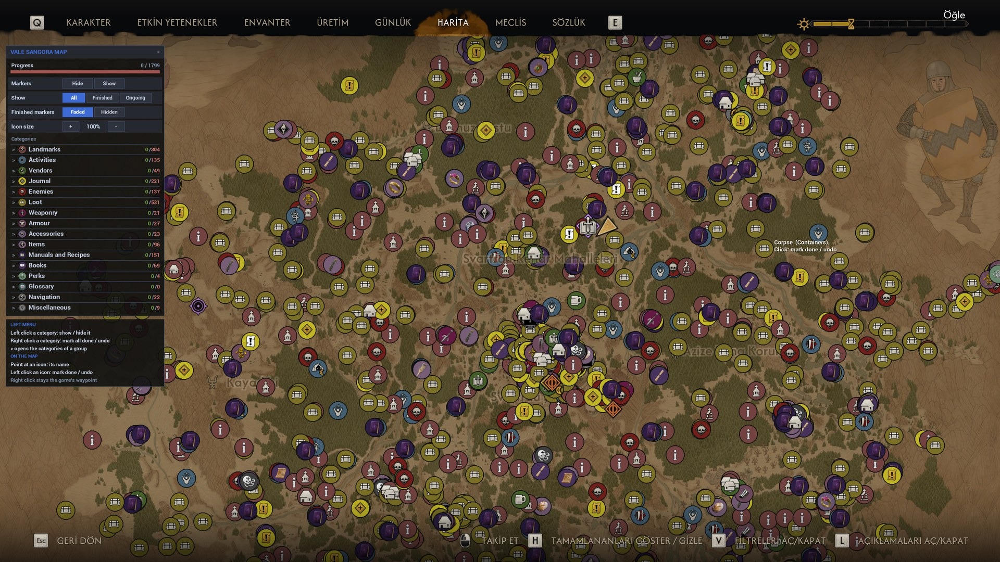
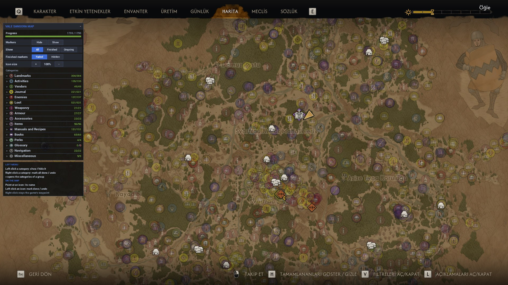
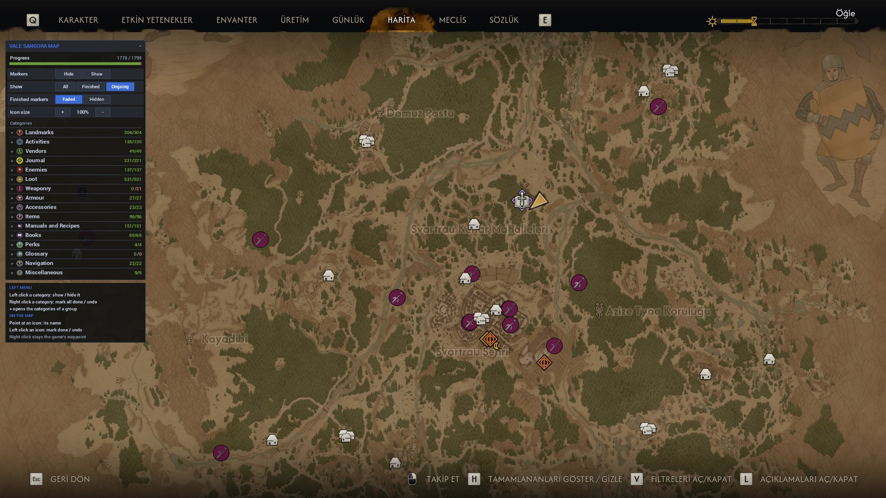
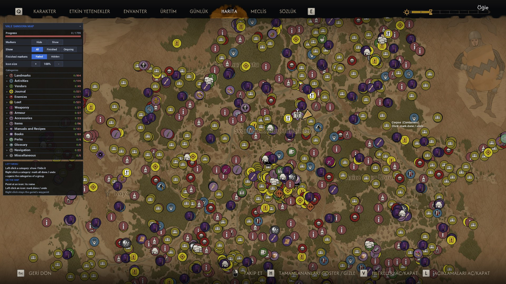

<div align="center">

<picture>
  <source media="(prefers-color-scheme: dark)" srcset="./assets/logo-dark.svg">
  
</picture>

# ValeSangora-InGameMap

**1799 marcadores de la comunidad para The Blood of Dawnwalker, dibujados en el propio mapa del juego. Un mod Lua para UE4SS: copia una carpeta y juega.**

[](./LICENSE)
[](https://github.com/Miabeyefendi/ValeSangora-InGameMap/releases/latest)
[](#-instalación)
[](#)
[](https://github.com/Miabeyefendi)

[English](./README.md) · [Türkçe](./README_TR.md) · **Español** · [简体中文](./README_ZH.md) · [Русский](./README_RU.md)

[Instalación](#-instalación) · [Funciones](#-lo-destacado) · [Uso](#-inicio-rápido) · [Cambios](./CHANGELOG.md)

<a href="https://github.com/Miabeyefendi/ValeSangora-InGameMap/releases/latest">
  
</a>
<a href="#-inicio-rápido">
  <picture>
    <source media="(prefers-color-scheme: dark)" srcset="./assets/btn-quick-start-dark.svg">
    
  </picture>
</a>



</div>

---

## ✨ Lo destacado

- **En el propio mapa del juego** - pulsa M como siempre, los marcadores ya están ahí, sin segunda ventana
- **1799 marcadores, 79 categorías** - santuarios, campamentos, vendedores, misiones, cofres, manuales, libros, enemigos y más
- **Pegados al mapa** - los marcadores se mueven y hacen zoom con el mapa, su tamaño coincide con los pines del juego
- **Nombre al pasar el ratón** - apunta a un marcador para leer su nombre y categoría
- **Marcar como hecho** - clic izquierdo en un marcador y se atenúa; otro clic izquierdo lo deshace
- **Marcar una categoría entera** - clic derecho en una categoría del panel y todos sus marcadores quedan hechos
- **Panel de filtros** - muestra u oculta cualquier grupo o categoría, con el recuento hechos / total
- **Todos, Terminados o Pendientes** - y los terminados atenuados u ocultos del todo
- **Solo archivos Lua, de texto y PNG** - nada que ejecutar, nada que instalar aparte de UE4SS
- **El progreso se guarda** - en un pequeño archivo de texto en la carpeta del mod

---

## 📦 Instalación

### Requisitos

| | |
|---|---|
| Juego | The Blood of Dawnwalker (PC) |
| Cargador de mods | [UE4SS](https://github.com/UE4SS-RE/RE-UE4SS/releases) 3.0.1 o posterior, funcionando con el juego |
| Sistema | Windows 10 u 11 |

Nada más. Sin Node.js, sin Python, sin archivos .exe ni .bat.

### Construido con


### Instalar

1. **Encuentra la carpeta del juego.** Es la carpeta que contiene `Dawnwalker.exe`. En Steam: clic derecho en el juego, **Administrar**, **Ver archivos locales**.
2. **Comprueba UE4SS.** Abre `Dawnwalker\Binaries\Win64`. Si hay una carpeta llamada `ue4ss`, UE4SS está instalado: ve al paso 4.
3. **Instala UE4SS.** Descarga `UE4SS_v3.0.1.zip` (no el de `zDEV`) desde las [versiones de UE4SS](https://github.com/UE4SS-RE/RE-UE4SS/releases), ábrelo y copia todo su contenido en `Dawnwalker\Binaries\Win64`.
4. **Descarga este mod.** Obtén `ValeSangoraMap-1.0.0.zip` en la [página de versiones](https://github.com/Miabeyefendi/ValeSangora-InGameMap/releases/latest).
5. **Copia la carpeta.** Abre el zip y copia la carpeta `ValeSangoraMap` en `Dawnwalker\Binaries\Win64\ue4ss\Mods`.

Si está bien, este archivo existe:

```
Dawnwalker\Binaries\Win64\ue4ss\Mods\ValeSangoraMap\enabled.txt
```

<details>
<summary><b>Instalar desde este repositorio</b></summary>

1. Pulsa **Code** y luego **Download ZIP**, o clona el repositorio:
   ```bash
   git clone https://github.com/Miabeyefendi/ValeSangora-InGameMap.git
   ```
2. Copia la carpeta `src\ValeSangoraMap` en `Dawnwalker\Binaries\Win64\ue4ss\Mods`.

</details>

---

## 🚀 Inicio rápido

1. Inicia el juego y carga una partida.
2. Pulsa **M**. Los marcadores aparecen en el mapa en un segundo. El panel de filtros está a la izquierda.
3. Apunta a un marcador para leer su nombre. Haz clic izquierdo cuando lo hayas completado.

| Dónde | Acción | Resultado |
|---|---|---|
| Mapa | Apuntar a un marcador | Su nombre y categoría |
| Mapa | Clic izquierdo en un marcador | Marcado como hecho, otro clic lo deshace |
| Mapa | Clic derecho | El punto de ruta del propio juego, como siempre |
| Panel | Clic izquierdo en un grupo o categoría | Mostrar / ocultar |
| Panel | Clic derecho en un grupo o categoría | Marcarlo todo como hecho, otro clic derecho lo deshace |
| Panel | `>` | Abrir las categorías de un grupo |
| Panel | Barra de título | Plegar el panel |

---

## 🖼️ Capturas de pantalla

<table>
<tr>
  <td align="center" width="50%">
    <br/>
    <sub><b>Todo hecho, atenuado</b> · lo terminado sigue visible pero discreto</sub>
  </td>
  <td align="center" width="50%">
    <br/>
    <sub><b>Pendientes</b> · solo lo que falta</sub>
  </td>
</tr>
<tr>
  <td align="center" width="50%">
    <br/>
    <sub><b>Panel de filtros</b> · cada grupo con su recuento hechos / total</sub>
  </td>
  <td align="center" width="50%">
    <br/>
    <sub><b>Todo activado</b> · 1799 marcadores con nombre al pasar el ratón</sub>
  </td>
</tr>
</table>

---

## ⚙️ Configuración

Todo se ajusta desde el panel de la pantalla del mapa. El mod lo guarda en archivos de texto junto a él:

| Archivo | Qué contiene |
|---|---|
| `ValeSangoraMap\progress.txt` | Los marcadores que marcaste como hechos. Cópialo para respaldar tu progreso. |
| `ValeSangoraMap\settings.txt` | Categorías ocultas, modo Show, Faded / Hidden, tamaño de iconos |
| `ValeSangoraMap\vsm.log` | Lo que hizo el mod, para informes de errores |
| `ValeSangoraMap\guard.txt` | El paso en curso, usado por la protección contra cierres |

| Fila del panel | Opciones |
|---|---|
| Markers | Hide (ocultar todo), Show (mostrar todo) |
| Show | All (todos), Finished (terminados), Ongoing (pendientes) |
| Finished markers | Faded (atenuados), Hidden (ocultos), con Show en All |
| Icon size | + / - en pasos del 5%, del 50% al 200% |

---

## 📖 Documentación

- [**Cambios**](./CHANGELOG.md) - qué cambió en cada versión
- [**Contribuir**](./CONTRIBUTING.md) - cómo enviar un cambio
- [**Seguridad**](./SECURITY.md) - cómo informar de una vulnerabilidad en privado

---

## 🧭 Hoja de ruta

- [ ] Marcado automático desde el juego: lugares terminados, misiones y cofres vaciados
- [ ] Cuadro de búsqueda en el panel
- [x] Panel de filtros, marcar una categoría entera, protección contra cierres

Nada de esto es una promesa. Es un proyecto personal y la lista cambia cuando cambian mis prioridades.

---

## ❓ Preguntas frecuentes

<details>
<summary><b>Pulso M y no veo marcadores.</b></summary>

Comprueba que existe `ue4ss\Mods\ValeSangoraMap\enabled.txt` (paso 5). Carga primero una partida, el menú principal no tiene mapa. Si UE4SS no arranca, no se crea `UE4SS.log` en la carpeta `ue4ss`; arregla UE4SS primero.

</details>

<details>
<summary><b>¿Cambia mi partida guardada?</b></summary>

No. El mod solo dibuja en la pantalla del mapa. Tu progreso de marcadores está en `progress.txt` dentro de la carpeta del mod, no en la partida.

</details>

<details>
<summary><b>¿Sabe lo que ya hice en el juego?</b></summary>

Todavía no. Márcalo tú: clic izquierdo en un marcador o clic derecho en una categoría del panel. El marcado automático está en la hoja de ruta.

</details>

<details>
<summary><b>El juego se cerró. ¿Y ahora?</b></summary>

Vuelve a iniciar el juego. Si el mod estaba a mitad de algo, `vsm.log` empieza con la línea `previous session ended during: ...` y esa sesión funciona en un modo más lento y seguro. Abre un issue con esa línea.

</details>

<details>
<summary><b>¿Cómo lo quito?</b></summary>

Borra la carpeta `ue4ss\Mods\ValeSangoraMap`. Si quizá vuelvas, guarda antes `progress.txt` en otro sitio.

</details>

<details>
<summary><b>¿Es lo mismo que Vale Sangora Live Map?</b></summary>

No. [Vale Sangora Live Map](https://github.com/Miabeyefendi/vale-sangora-live-map) es una ventana de mapa aparte con posición en vivo y marcado automático, y necesita Node.js. Este mod dibuja en el mapa del juego y solo necesita UE4SS. Sus archivos de progreso son independientes.

</details>

---

## 🤝 Contribuir

Las contribuciones son bienvenidas. Lee primero [CONTRIBUTING.md](./CONTRIBUTING.md)
y [CODE_OF_CONDUCT.md](./CODE_OF_CONDUCT.md). Al contribuir aceptas licenciar tu
trabajo bajo la AGPL-3.0.

<div align="center">
<a href="https://github.com/Miabeyefendi/ValeSangora-InGameMap/issues/new?template=bug_report.yml">
  <picture>
    <source media="(prefers-color-scheme: dark)" srcset="./assets/btn-report-bug-dark.svg">
    
  </picture>
</a>
<a href="https://github.com/Miabeyefendi/ValeSangora-InGameMap/stargazers">
  <picture>
    <source media="(prefers-color-scheme: dark)" srcset="./assets/btn-star-dark.svg">
    
  </picture>
</a>
</div>

---

## 🙏 Créditos

- **Las posiciones, nombres y categorías de los marcadores** vienen del mapa de la comunidad de
  [GamerGuides](https://www.gamerguides.com/the-blood-of-dawnwalker/maps/vale-sangora),
  con marcadores extra de [MapGenie](https://mapgenie.io/the-blood-of-dawnwalker/maps/vale-sangora). El contenido es suyo.
  Tomado: dónde están las cosas y cómo se llaman. Añadido: dibujarlas dentro del juego, filtros, progreso y marcado.
- **[UE4SS](https://github.com/UE4SS-RE/RE-UE4SS)**, del equipo de UE4SS, ejecuta el script Lua dentro del juego.
- The Blood of Dawnwalker es un juego de Rebel Wolves. Este mod no está afiliado a ellos.

---

## 🛡️ Seguridad

¿Has encontrado una vulnerabilidad? No abras una incidencia pública. Sigue el
proceso privado descrito en [SECURITY.md](./SECURITY.md).

---

## 📜 Licencia

Este proyecto está licenciado bajo la **GNU Affero General Public License v3.0
(AGPL-3.0)**, junto con los términos suplementarios del archivo
[NOTICE](./NOTICE). En resumen:

- Puedes usar, estudiar, modificar, redistribuir e incluso ganar dinero con este
  software de forma gratuita, **siempre que** mantengas el código fuente completo
  disponible bajo la AGPL-3.0, incluido cualquier uso alojado, SaaS o en red
  (AGPL Sección 13), y conserves la atribución de autoría indicada abajo.
- Para usar esta obra en un producto propietario o de código cerrado, o para
  ejecutarla como un SaaS cerrado, necesitas una **licencia comercial escrita
  aparte**, que puede incluir regalías o reparto de ingresos. Consulta
  [NOTICE](./NOTICE), Sección 8, y contacta conmigo.

Los datos de marcadores en `src\ValeSangoraMap\Data` son contenido de terceros (ver Créditos) y no están cubiertos por esta licencia.

### Atribución (obligatoria)

Según la Sección 7(b) de la AGPL-3.0, la siguiente atribución debe conservarse de
forma visible y sin modificar en cualquier copia, bifurcación o despliegue de
este proyecto:

> **Miabeyefendi (Mustafa Ihsan Albayrak)** - https://github.com/Miabeyefendi

### Descargo de responsabilidad

Este software se proporciona "tal cual", sin garantía de ningún tipo. Lo ejecutas
por tu cuenta y riesgo y eres la única persona responsable de tu propio uso,
incluido el cumplimiento de los términos de servicio de cualquier plataforma de
terceros con la que interactúe. Esas plataformas no están afiliadas al autor ni
lo respaldan; sus nombres y marcas pertenecen a sus respectivos propietarios. El
autor no acepta responsabilidad alguna por bloqueos de cuenta, pérdida de datos
ni ningún otro daño, en la máxima medida permitida por la ley aplicable. Los
términos completos están en los archivos [LICENSE](./LICENSE) y
[NOTICE](./NOTICE).

---

## 📬 Contacto

- GitHub: [@miabeyefendi](https://github.com/Miabeyefendi)
- Para licencias comerciales o consultas sobre reparto de ingresos, escríbeme a
  través de mi perfil de GitHub.

<div align="center">
<br/>

<br/>
<sub>Creado por <b><a href="https://github.com/Miabeyefendi">Miabeyefendi</a></b></sub>
</div>
