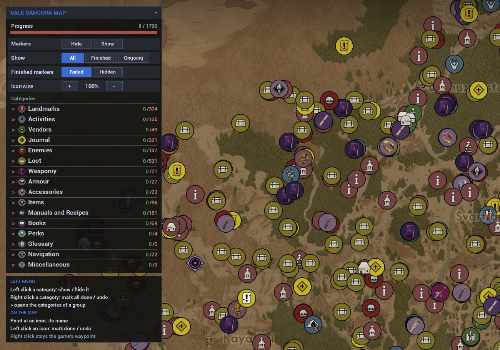

<div align="center">

# 📖 Guía de ValeSangora-InGameMap

**1.0.0 · Última actualización 2026-10-02**

[English](./TUTORIAL.md) · [Türkçe](./TUTORIAL_TR.md) · **Español** · [简体中文](./TUTORIAL_ZH.md) · [Русский](./TUTORIAL_RU.md)

[Volver al README](./README_ES.md) · [Cambios](./CHANGELOG.md)

</div>

---

Este documento explica qué hace cada parte de ValeSangora-InGameMap, cómo funciona por dentro y
qué cambia realmente cada ajuste. Si solo quieres instalarlo y ejecutarlo, el
[README](./README_ES.md) es más corto.

## 📑 Contenido

- [Visión general](#-visión-general)
- [Instalación](#-instalación)
- [Recorrido por la interfaz](#️-recorrido-por-la-interfaz)
- [Referencia de funciones](#-referencia-de-funciones)
- [Referencia de configuración](#️-referencia-de-configuración)
- [Resolución de problemas](#-resolución-de-problemas)
- [Preguntas frecuentes](#-preguntas-frecuentes)
- [Glosario](#-glosario)

---

## 🔭 Visión general

### Qué hace

El mapa de The Blood of Dawnwalker es bueno, pero no muestra la mayoría de coleccionables y
lugares que ha encontrado la comunidad. Este mod toma 1799 de esos marcadores (79 categorías,
desde santuarios y campamentos hasta manuales, libros y cofres) y los dibuja en el propio mapa
del juego, el que abres con M.

Puedes apuntar a un marcador para leer su nombre, marcarlo como hecho con un clic izquierdo,
ocultar categorías enteras y hacer que los terminados se atenúen o desaparezcan. Todo se guarda
en la carpeta del mod.

Es un mod Lua para UE4SS. No hay ningún programa que iniciar ni nada que instalar aparte de UE4SS.

### Cómo funciona

1. Cuando el juego carga el mod, este lee `Data\markers.txt` (categorías y posiciones en el
   mundo), `progress.txt` y `settings.txt`.
2. Al abrir el mapa, añade una capa al contenedor de pines del propio mapa y coloca cada
   marcador con la función del juego que convierte el mundo en mapa, 60 marcadores por fotograma
   (medio segundo para todos).
3. Al hacer zoom solo cambia la escala de la capa, así que los marcadores siguen pegados al mapa.
   Cuando el zoom se detiene, los iconos se ajustan al tamaño de los pines del juego, que el mod
   mide en el mapa.
4. El sistema de interfaz del juego indica qué icono está bajo el ratón. Así encuentran el
   marcador correcto el paso del ratón y los clics, sin cálculos de pantalla.
5. Los clics y los cambios de filtro se procesan de uno en uno en el hilo del juego. El paso en
   curso se escribe en `guard.txt`, para poder rastrear un cierre en el siguiente inicio.

```
markers.txt ──> se abre el mapa (M) ──> una capa en el contenedor de pines del mapa
                                         ├─ 1799 iconos, colocados con WorldToMapPosition
                                         ├─ zoom: solo la escala de la capa
                                         └─ ratón / clic: la interfaz del juego dice qué icono
progress.txt <── clic izquierdo en un marcador, clic derecho en una categoría
settings.txt <── panel de filtros
```

### Estructura de archivos

| Ruta | Qué contiene |
|---|---|
| `ValeSangoraMap\enabled.txt` | Indica a UE4SS que cargue el mod. Archivo vacío. |
| `ValeSangoraMap\Scripts\main.lua` | Todo el mod |
| `ValeSangoraMap\Data\markers.txt` | Categorías y los 1799 marcadores con posiciones en el mundo |
| `ValeSangoraMap\Icons\*.png` | Un icono por categoría y grupo |
| `ValeSangoraMap\progress.txt` | Lo escribe el mod: tus marcadores terminados |
| `ValeSangoraMap\settings.txt` | Lo escribe el mod: tus elecciones del panel |
| `ValeSangoraMap\vsm.log` | Lo escribe el mod: lo que ocurrió, para informes de fallos |
| `ValeSangoraMap\guard.txt` | Lo escribe el mod: el paso en curso |

En este repositorio la carpeta del mod es `src\ValeSangoraMap`.

---

## 📦 Instalación

### Requisitos

| Requisito | Por qué |
|---|---|
| The Blood of Dawnwalker (PC) | El mod dibuja en su pantalla de mapa |
| UE4SS 3.0.1 o posterior, funcionando con el juego | Carga los mods Lua en el juego; sin él no funciona nada |
| Windows 10 u 11 | El juego y UE4SS funcionan en Windows |

### Paso a paso

1. Encuentra la carpeta del juego: en Steam, clic derecho en el juego, **Administrar**,
   **Ver archivos locales**.
2. Abre `Dawnwalker\Binaries\Win64`. Si no hay carpeta `ue4ss`, descarga `UE4SS_v3.0.1.zip`
   (no `zDEV`) desde las [versiones de UE4SS](https://github.com/UE4SS-RE/RE-UE4SS/releases) y
   copia todo su contenido en `Win64`.
3. Descarga `ValeSangoraMap-1.0.0.zip` desde la
   [página de versiones](https://github.com/Miabeyefendi/ValeSangora-InGameMap/releases/latest).
4. Copia la carpeta `ValeSangoraMap` del zip en `Dawnwalker\Binaries\Win64\ue4ss\Mods`.
5. Inicia el juego, carga una partida, pulsa **M**.

### Verificar la instalación

Abre `ue4ss\Mods\ValeSangoraMap\vsm.log` después de iniciar el juego. Contiene:

```
loaded 79 categories, 1799 markers
ready, open the M map
```

Después de abrir el mapa una vez, siguen estas líneas:

```
layer created at zoom ..., building 1799 markers
all markers built
```

### Actualizar

Copia la nueva carpeta `ValeSangoraMap` sobre la anterior y deja que Windows reemplace los
archivos. `progress.txt` y `settings.txt` no están en el zip, así que tu progreso y tus
elecciones se conservan.

### Desinstalar

Borra `ue4ss\Mods\ValeSangoraMap`. El mod no escribe en ningún otro sitio y nunca toca tu
partida guardada.

---

## 🖥️ Recorrido por la interfaz

<div align="center">
  
  <br/>
  <sub><b>Panel de filtros</b> · todo lo que el mod puede hacer, en la pantalla del mapa</sub>
</div>

### Panel de filtros

Arriba a la izquierda de la pantalla del mapa. Haz clic en su barra de título para plegarlo.

| Control | Qué hace |
|---|---|
| `Progress` | Marcadores terminados / todos, con una barra verde |
| `Markers: Hide / Show` | Oculta o muestra todas las categorías a la vez |
| `Show: All / Finished / Ongoing` | Todos, solo los terminados o solo los que faltan |
| `Finished markers: Faded / Hidden` | Con Show en All: terminados atenuados o sin dibujar |
| `Icon size: + / -` | Tamaño de los marcadores en pasos del 5%, del 50% al 200% |
| Fila de grupo, clic izquierdo | Muestra u oculta todo el grupo |
| Fila de grupo, clic derecho | Marca todo el grupo como hecho, otro clic derecho lo deshace |
| `>` en una fila de grupo | Abre sus categorías debajo (un grupo a la vez) |
| Fila de categoría, clic izquierdo / derecho | Igual que un grupo, para una categoría |
| `d / t` a la derecha | Terminados (verde) / todos (rojo) en esa fila, todo verde al completarla |

### Caja de ayuda

Debajo del panel. Una lista corta de las acciones del ratón, para que nadie tenga que
recordarlas.

### En el mapa

| Control | Qué hace |
|---|---|
| Apuntar a un marcador | Su nombre y categoría, a su lado |
| Clic izquierdo en un marcador | Marcar como hecho, otro clic izquierdo lo deshace |
| Clic derecho | El punto de ruta del propio juego, sin cambios |
| Arrastrar, rueda | Mover y hacer zoom como siempre; los marcadores siguen |

---

## 🧩 Referencia de funciones

### Marcadores en el mapa del juego

**Qué hace.** Dibuja 1799 marcadores de la comunidad en el mapa de la tecla M.

**Cómo funciona.** Se añade una capa al contenedor de pines del mapa. Las posiciones salen de la
función del propio juego que convierte el mundo en mapa, por eso coinciden con los pines del
juego. Construirlos tarda medio segundo (60 marcadores por fotograma). El zoom solo cambia la
escala de la capa.

**Cómo se usa.** Abre el mapa. Nada más.

**Límites.** Las posiciones vienen del mapa de la comunidad; algunas pueden desviarse unos metros.

---

### Nombre al pasar el ratón

**Qué hace.** Muestra el nombre y la categoría del marcador bajo el ratón.

**Cómo funciona.** El sistema de interfaz del juego indica el icono bajo el ratón. El mod revisa
150 iconos por fotograma buscando uno nuevo, y el actual en cada fotograma.

**Cómo se usa.** Apunta a un marcador.

**Límites.** Los marcadores ocultos no muestran nombre.

---

### Marcar como hecho

**Qué hace.** El clic izquierdo alterna un marcador entre hecho y no hecho.

**Cómo funciona.** El clic espera 0,25 segundos. Si el mapa se movió o hizo zoom en ese tiempo,
era un arrastre y no se marca nada. El número del marcador se guarda en `progress.txt`.

**Cómo se usa.** Clic izquierdo en un marcador. Otro clic izquierdo lo deshace.

**Límites.** El mod no lee lo que hiciste en el juego. Lo marcas tú.

---

### Marcar una categoría entera

**Qué hace.** Clic derecho en un grupo o categoría del panel: todos sus marcadores quedan hechos.

**Cómo funciona.** Si queda algo sin hacer, todo pasa a hecho. Si ya estaba todo hecho, todo
pasa a no hecho.

**Cómo se usa.** Clic derecho en la fila. Otro clic derecho lo deshace.

**Límites.** Deshacer limpia todos los marcadores de esa fila, también los marcados uno a uno.

---

### Filtros

**Qué hace.** Muestra u oculta grupos y categorías, y elige Todos, Terminados o Pendientes.

**Cómo funciona.** Los cambios se aplican a 300 iconos por fotograma, así que incluso 1799
cambios tardan pocos fotogramas. Las elecciones se guardan en `settings.txt`.

**Cómo se usa.** Clic izquierdo en las filas y botones del panel.

**Límites.** Todavía no hay cuadro de búsqueda.

---

### Marcadores terminados: atenuados u ocultos

**Qué hace.** Con Show en All, los terminados se dibujan al 30% de opacidad (Faded) o no se
dibujan (Hidden).

**Cómo funciona.** Hidden funciona como Ongoing: los terminados no se dibujan ni muestran nombre.

**Cómo se usa.** Haz clic en Faded o Hidden en el panel.

**Límites.** Con Show en Finished, los terminados siempre se ven completos.

---

### Tamaño de iconos

**Qué hace.** Hace los marcadores más grandes o más pequeños.

**Cómo funciona.** El tamaño base es el de los pines del propio juego, medido en el mapa tras
cada zoom. El ajuste del panel lo multiplica.

**Cómo se usa.** Haz clic en + o - en la fila Icon size.

**Límites.** Del 50% al 200%.

---

### Protección contra cierres

**Qué hace.** Evita que un problema del mod se acumule y te dice dónde ocurrió.

**Cómo funciona.** Los errores de Lua se capturan; 10 errores en 10 segundos pausan el mod 30
segundos. Cada paso pesado escribe su nombre en `guard.txt` e `idle` al terminar. Si el juego
se cerró a mitad de un paso, el siguiente inicio registra `previous session ended during: <paso>`
y ejecuta esa sesión con lotes más pequeños y clics más lentos. Al cargar una partida o un
nivel, el mod suelta toda referencia al mapa anterior antes de que se destruya.

**Cómo se usa.** No hay nada que hacer. Lee `vsm.log` si algo fue mal.

**Límites.** Un cierre dentro del propio juego o de UE4SS no se puede capturar, solo rastrear.

---

## ⚙️ Referencia de configuración

Cada ajuste, qué acepta y qué pasa al cambiarlo.

### settings.txt

Un ajuste por línea, clave y valor separados por un tabulador. Lo escribe el panel; nunca hace
falta editarlo.

| Clave | Tipo | Por defecto | Efecto |
|---|---|---|---|
| `done` | `all`, `finished`, `ongoing` | `all` | La fila Show |
| `style` | `faded`, `hidden` | `faded` | La fila Finished markers |
| `size` | número, de `0.50` a `2.00` | `1.00` | La fila Icon size |
| `offcat` | clave de categoría | ninguno | Una línea por categoría oculta |

### progress.txt

| Clave | Tipo | Por defecto | Efecto |
|---|---|---|---|
| una línea por marcador | número del marcador | vacío | Ese marcador cuenta como hecho |

### Dónde se guardan los ajustes

Ambos archivos están en la carpeta del mod, `ue4ss\Mods\ValeSangoraMap`. Son texto plano.
Edítalos solo con el juego cerrado, el mod los escribe mientras funciona. Haz copia de
`progress.txt` para conservar tu progreso. Ninguno contiene datos de cuentas.

---

## 🔧 Resolución de problemas

### Pulso M y no veo marcadores

**Causa.** El mod no está cargado o todavía no hay partida cargada.
**Solución.** Comprueba que existe `ue4ss\Mods\ValeSangoraMap\enabled.txt` y que `vsm.log` dice
`ready, open the M map`. Carga una partida; el menú principal no tiene mapa.

### No funciona ningún mod

**Causa.** UE4SS no está en marcha.
**Solución.** Instala UE4SS de nuevo (Instalación, paso 2). Cuando funciona, se escribe
`ue4ss\UE4SS.log`.

### Los marcadores son demasiado grandes o pequeños

**Causa.** Tamaño de pantalla y gusto.
**Solución.** Usa Icon size + / - en el panel.

### Hacer clic en un marcador no hace nada

**Causa.** El mapa se movió durante el clic (un arrastre) o el clic llegó justo después de otro.
**Solución.** Haz clic sin mover el ratón. Se aceptan como mucho cinco clics por segundo.

### Recoger un registro para informar de un fallo

Envía `ue4ss\Mods\ValeSangoraMap\vsm.log` y, si el juego se cerró, las primeras líneas del
`vsm.log` del siguiente inicio. También sirven las últimas líneas de `ue4ss\UE4SS.log`. Estos
archivos no contienen datos de cuentas, pero revísalos antes de publicarlos.

---

## ❓ Preguntas frecuentes

**¿Cambia mi partida guardada?**
No. El mod solo dibuja en la pantalla del mapa. El progreso está en `progress.txt`.

**¿Puedo usarlo junto con Vale Sangora Live Map?**
Sí. Son independientes, y sus archivos de progreso también.

**¿Puedo añadir mis propios marcadores?**
Añade líneas a `Data\markers.txt` con el mismo formato (clave de categoría, X del mundo, Y del
mundo, un número único, título, separados por tabuladores). Una actualización reemplaza este
archivo.

---

## 📕 Glosario

| Término | Significado |
|---|---|
| UE4SS | El cargador que ejecuta mods Lua en juegos de Unreal Engine |
| Marcador | Un punto dibujado por este mod |
| Pin | Uno de los iconos propios del mapa del juego |
| Grupo | Una fila superior del panel, como Loot; contiene categorías |
| Categoría | Una fila dentro de un grupo, como Containers |
| Terminado | Marcado como hecho por ti |
| Modo seguro | Una sesión con pasos más pequeños, tras un cierre del juego durante un paso del mod |

---

<div align="center">

<br/>
<sub>Creado por <b><a href="https://github.com/Miabeyefendi">Miabeyefendi</a></b> · <a href="./README_ES.md">Volver al README</a></sub>
</div>
